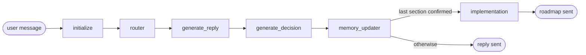
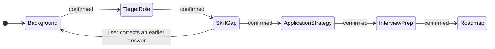
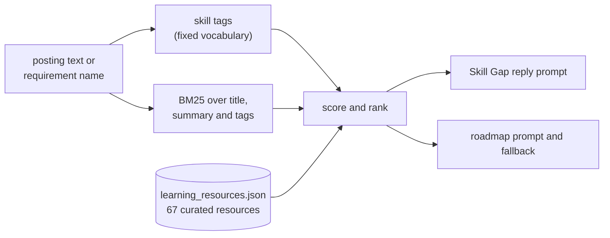
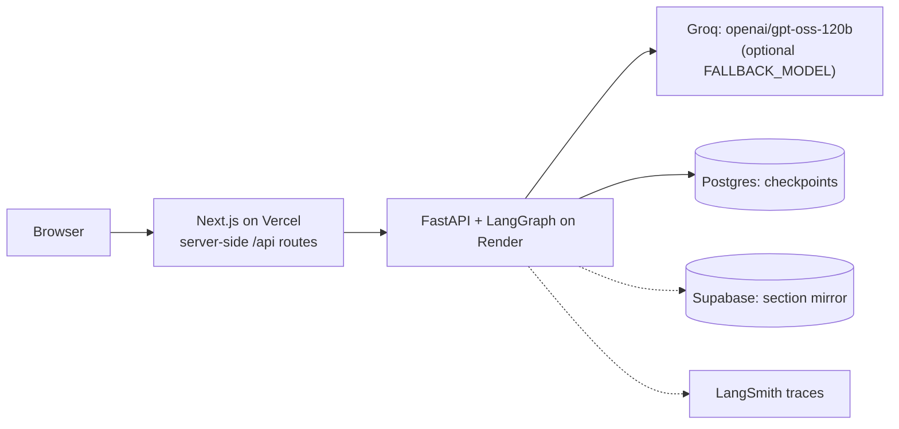

# JobBuddy architecture

JobBuddy is a LangGraph state machine. The model writes replies and proposes what
to do next; code decides. Every message runs one pass through the graph, and the
graph's state is checkpointed in Postgres, so a conversation survives restarts.

## One turn through the graph

| Node | Model call? | What it does |
| --- | --- | --- |
| `initialize` | no | Restores the thread from its checkpoint, or creates it. |
| `router` | no | Applies the previous decision: stay, move to the next unfinished section, or reopen an earlier one. Loads that section's prompt. |
| `generate_reply` | yes, streamed | Writes the reply from the section prompt, a block with every section's real status, the confirmed recap of earlier sections, and the section's short memory. An empty reply is retried once, then replaced with a fixed apology. |
| `generate_decision` | yes, JSON | Proposes `stay`, `next` or `modify:<section>`, a summary, and which checklist items are covered. Code validates it (below). |
| `memory_updater` | yes, on confirmation | Saves drafts. When a section is confirmed, extracts structured data with quoted evidence and checks the decision's claims against it. |
| `implementation` | yes | Writes the roadmap, checks it, rewrites once with the failed checks, and falls back to a deterministic roadmap if it still fails. |

## The five sections

Each section opens with one broad question. The agent records everything the user
gives and asks only for what is missing, then shows a summary and waits for the
user to confirm. Any section can be reopened from a later one (`modify`).

## Guardrails: what code checks before it believes the model

| Check | Where | Stops |
| --- | --- | --- |
| `next` needs `is_satisfied`, a summary, and every required field | `generate_decision` | Skipping a section, or confirming one with data missing |
| The decision sees the whole section (saved draft plus recent messages), not only the last exchange | `generate_decision` | A confirmed section staying stuck because earlier answers were out of view |
| Skill gap needs a real pasted posting | `generate_decision` | Gaps built from self-assessment |
| No `next` into the roadmap while the reply asks a question | `generate_decision` | The roadmap arriving before the user answers |
| A plain "yes" to a confirmation prompt with the checklist complete advances even if the model says "stay"; a "yes" that adds something sends the next reply back to re-confirm | `generate_decision` | The section stuck while the chat ran ahead after the model answered "stay" to a confirmation |
| Reply prompt carries the real status of every section | `generate_reply` | The model walking ahead of the state and writing its own roadmap |
| Extracted data must quote the user's own words or posting | `memory_updater` | Untraceable requirements and invented counts |
| Roadmap checks: structure, grounding, completeness, contradictions | `implementation` | A roadmap that is malformed, ungrounded, or contradicts confirmed data |
| Every link in the roadmap must come from the learning-resource library (or the user's own posting) | `implementation` | Invented courses and dead links |

## Learning resources (retrieval)

Suggesting courses is where a model invents the most: titles that don't exist and
links that 404. JobBuddy retrieves from a small curated library instead, and the
prompts allow only what was retrieved.

- **Library:** `src/agents/xbuddy/knowledge/learning_resources.json`. Each entry has
  skill tags, level, cost and format.
- **Retrieval:** a resource is eligible only if it shares a skill tag with the query
  (a fixed vocabulary that knows "k8s" is Kubernetes and that "react quickly" is not
  React). BM25 then ranks the eligible ones. No embeddings, so no extra API calls,
  no quota, and nothing heavy to load on Render. A requirement like "5 years of
  experience" retrieves nothing rather than something irrelevant.
- **Skill Gap:** the reply prompt gets one resource per skill named in the pasted
  posting, gaps first and skills the user already has last.
- **Roadmap:** the prompt gets resources for the top requirements and must cite only
  those. `validate_roadmap` rejects any other link; the fallback roadmap lists the
  resources and strips links the summaries carried.
- **Evaluation:** two labeled sets, run with
  `cd src && python -m agents.xbuddy.knowledge.evaluation [cases.json]`.

  | Set | Cases | hit@3 | MRR | Negatives correct |
  | --- | --- | --- | --- | --- |
  | Development (`retrieval_eval.json`, written with the vocabulary) | 50 + 10 | 1.0 | 0.99 | 10 of 10 |
  | Held out (`retrieval_eval_heldout.json`, 3 real postings), first run | 23 + 6 | 0.83 | 0.75 | 3 of 6 |
  | Held out, after two structural fixes | 23 + 6 | 0.83 | 0.75 | 5 of 6 |

  The two structural fixes improved only the negatives (3 to 5 of 6); hit@3 and MRR
  did not change. After review, "retrieval" on its own no longer counts as RAG
  ("a retrieval pipeline" is not RAG); two negative cases cover it, and the held-out
  scores are unchanged.

  The held-out run found a bug ("C#/.NET" was missed because a slash counted as part
  of the word) and showed that letting a strong BM25 match through without a skill
  tag returned wrong resources. Both were fixed without adding words from those
  postings to the vocabulary. The remaining misses are vocabulary gaps ("AI coding
  tools", "well-tested code", "distributed architectures"), which a new held-out set
  should measure after they are added.
- **Link check:** `cd src && python -m agents.xbuddy.knowledge.check_links` opens every
  library link and lists any that fail.

## Deployment

The browser only talks to the Next.js app; its `/api` routes call the API from the
server, so the API URL and any token stay out of the browser and there is no CORS
setup. `/stream` sends tokens as Server-Sent Events, then the section progress the
sidebar draws.

## Where to look

- Graph wiring: `src/agents/xbuddy/graph/builder.py`
- Nodes: `src/agents/xbuddy/nodes/`
- Section prompts and checklists: `src/agents/xbuddy/sections/`
- Roadmap checks: `src/agents/xbuddy/roadmap.py`
- Learning-resource library, retriever and evaluation: `src/agents/xbuddy/knowledge/`
- End-to-end regressions for live bugs: `tests/xbuddy/test_e2e_regressions.py`
