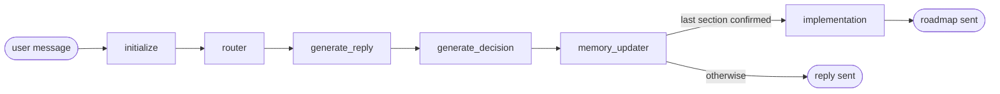
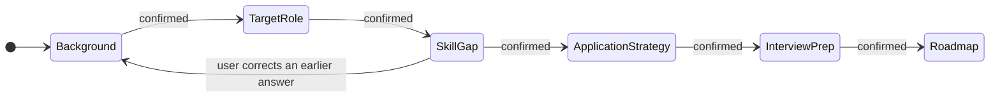
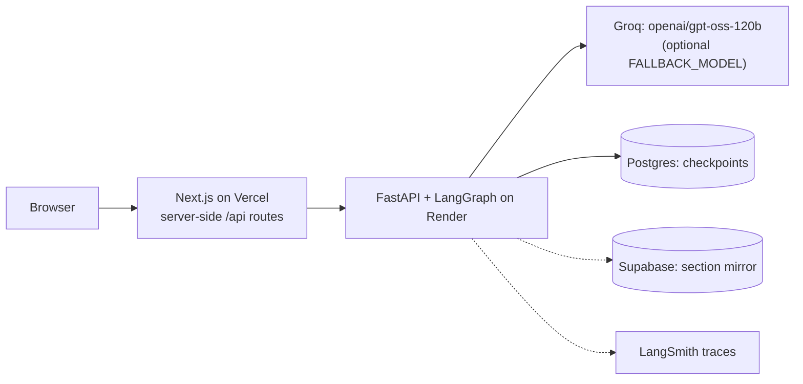

# JobBuddy architecture

JobBuddy is a LangGraph state machine. The model writes replies and proposes what
to do next; code decides. Every message runs one pass through the graph, and the
graph's state is checkpointed in Postgres, so a conversation survives restarts.

## One turn through the graph

| Node | Model call? | What it does |
| --- | --- | --- |
| `initialize` | no | Restores the thread from its checkpoint, or creates it. |
| `router` | no | Applies the previous decision: stay, move to the next unfinished section, or reopen an earlier one. Loads that section's prompt. |
| `generate_reply` | yes, streamed | Writes the reply from the section prompt, a block with every section's real status, the confirmed recap of earlier sections, and the section's short memory. An empty reply is retried once, then replaced with a fixed apology. |
| `generate_decision` | yes, JSON | Proposes `stay`, `next` or `modify:<section>`, a summary, and which checklist items are covered. Code validates it (below). |
| `memory_updater` | yes, on confirmation | Saves drafts. When a section is confirmed, extracts structured data with quoted evidence and checks the decision's claims against it. |
| `implementation` | yes | Writes the roadmap, checks it, rewrites once with the failed checks, and falls back to a deterministic roadmap if it still fails. |

## The five sections

Each section opens with one broad question. The agent records everything the user
gives and asks only for what is missing, then shows a summary and waits for the
user to confirm. Any section can be reopened from a later one (`modify`).

## Guardrails: what code checks before it believes the model

| Check | Where | Stops |
| --- | --- | --- |
| `next` needs `is_satisfied`, a summary, and every required field | `generate_decision` | Skipping a section, or confirming one with data missing |
| The decision sees the whole section (saved draft plus recent messages), not only the last exchange | `generate_decision` | A confirmed section staying stuck because earlier answers were out of view |
| Skill gap needs a real pasted posting | `generate_decision` | Gaps built from self-assessment |
| No `next` into the roadmap while the reply asks a question | `generate_decision` | The roadmap arriving before the user answers |
| Reply prompt carries the real status of every section | `generate_reply` | The model walking ahead of the state and writing its own roadmap |
| Extracted data must quote the user's own words or posting | `memory_updater` | Untraceable requirements and invented counts |
| Roadmap checks: structure, grounding, completeness, contradictions | `implementation` | A roadmap that is malformed, ungrounded, or contradicts confirmed data |

## Deployment

The browser only talks to the Next.js app; its `/api` routes call the API from the
server, so the API URL and any token stay out of the browser and there is no CORS
setup. `/stream` sends tokens as Server-Sent Events, then the section progress the
sidebar draws.

## Where to look

- Graph wiring: `src/agents/xbuddy/graph/builder.py`
- Nodes: `src/agents/xbuddy/nodes/`
- Section prompts and checklists: `src/agents/xbuddy/sections/`
- Roadmap checks: `src/agents/xbuddy/roadmap.py`
- End-to-end regressions for live bugs: `tests/xbuddy/test_e2e_regressions.py`
