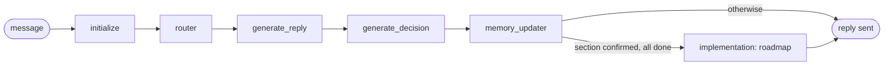
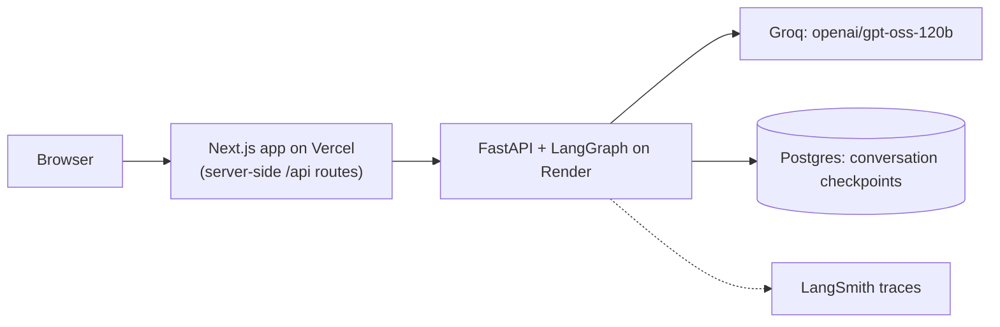

# JobBuddy

A job search coach built as a LangGraph agent. JobBuddy walks you through five
sections (your background, the role you want, the skill gaps real job postings
reveal, how you will apply, and how you will prepare for interviews), then writes
an eight-week roadmap built only from what you confirmed.

**Try it:** https://xbuddy-template.vercel.app (API docs: https://jobbuddy-api.onrender.com/docs)

> **Demo only.** There is no sign-in: anyone with the link can use it, and anyone
> who knows a conversation's id can read that conversation. Do not enter personal or
> sensitive information. The free API host sleeps when idle, so the first reply can
> take up to a minute.

Built by Safin Mahmud during the Brave Career AI Engineer Residency, starting from
the [xbuddy-template](https://github.com/TryMOSS/xbuddy-template).

**Demo (2 minutes):** [Loom walkthrough](https://www.loom.com/share/a069f5e0647c448fa3867a207c176d14), one real conversation from the first message to the roadmap.
**Architecture explanation:** [docs/architecture.md](docs/architecture.md) (graph,
state, guardrails and deployment, with diagrams).

## What it does

| Section | JobBuddy collects | Confirmed before moving on |
| --- | --- | --- |
| Background | current role, past roles, years of experience, skills, education | yes |
| Target role | titles, city, work arrangement, priorities | yes |
| Skill gap | real job postings you paste, the requirements in them, your gaps, one learning action | yes |
| Application strategy | resume and LinkedIn changes, channels, networking, weekly targets | yes |
| Interview preparation | interview types, weak areas, practice plan, stories | yes |

When the last section is confirmed, JobBuddy writes the roadmap: where you are, your
target, ranked skill gaps with the postings that ask for them, a learning plan,
application strategy, interview prep, an 8-week plan and this week's checklist.

Postings are pasted as text, from any job site or careers page. One is enough.

## How it works

Every message runs one pass through a LangGraph state machine:



| Node | Job |
| --- | --- |
| `initialize` | Restores the thread's state, or creates it for a new user. Safe to run every turn. |
| `router` | Applies the last decision in code: stay, move to the next unfinished section, or reopen an earlier one. |
| `generate_reply` | Writes the streamed reply from the section's prompt, the real section statuses and short memory. An empty model reply is retried, never sent. |
| `generate_decision` | Returns JSON (stay, next, modify) that code validates against the whole section. Advancing needs a confirmed summary with every required field, a real posting in Skill gap, and no open question before the roadmap. |
| `memory_updater` | Saves drafts, stores confirmed summaries, extracts structured data with source evidence, retries failed extraction. |
| `implementation` | Writes the roadmap, checks it, rewrites once if needed, and falls back to a deterministic version. |

The deployed system:



## Design decisions

- **Code decides, the model proposes.** The model suggests stay, next or modify;
  code validates it and refuses to advance without a confirmed summary that covers
  every required field. A model mistake can't skip a section or lose its data.
- **Nothing unconfirmed or untraceable is saved.** Drafts and confirmed answers are
  kept apart. Every skill-gap requirement must quote a posting the user supplied,
  and how often it appears is counted from that evidence, never stated by the model.
- **The roadmap is checked before anyone sees it.** Code checks structure,
  grounding, completeness and contradictions. A failing draft gets one rewrite, then
  a deterministic fallback, so five sections of effort always end in a roadmap.
- **Conversations survive restarts.** LangGraph checkpoints live in Postgres. A
  returning user reloads the page and continues where they left off.
- **The chat can't run ahead of the state.** Every reply prompt carries each
  section's real status, so the model can't discuss a section that hasn't started
  or write its own roadmap, and the sidebar always matches the conversation.
- **A feature that only works for its author is removed.** A job search tool
  (PRs 8 and 9) read a database scraped for one person's search: software roles in
  Ontario. It was close to useless for anyone else and tied JobBuddy to another
  project, so PR 11 removed it. Pasting a posting works for any job anywhere.
- **Test against real things.** API tests run the real app and database with fake
  models, and a signed-out smoke test runs the live site. Together they caught a
  startup crash, an async bug, and a stream that silently dropped the roadmap.

## Build history

Each phase was one pull request with a written tradeoff and evidence: LangSmith
traces where the PR made model calls, and state or smoke-test results where it did not.

| PR | What | Evidence | Tests at merge |
| --- | --- | --- | --- |
| [1](https://github.com/SafinMahmud/xbuddy-template/pull/1) | State schema and `initialize` | state evidence in the PR (no model calls yet) | 16 |
| [2](https://github.com/SafinMahmud/xbuddy-template/pull/2) | Router and five section prompts | route and state evidence in the PR (no model calls yet) | 43 |
| [3](https://github.com/SafinMahmud/xbuddy-template/pull/3) | Streamed reply and validated decision | LangSmith: [turn 1](https://smith.langchain.com/public/5f043fa3-98e4-46f9-819e-6b21d4204fd3/r), [turn 2](https://smith.langchain.com/public/00fe58cb-1d60-4640-8508-63b9feb28c15/r) | 86 |
| [4](https://github.com/SafinMahmud/xbuddy-template/pull/4) | Memory, extraction with evidence, Supabase mirror | LangSmith: [1](https://smith.langchain.com/public/896d601f-d4c2-4516-8278-035d8fe1f83a/r), [2](https://smith.langchain.com/public/6389234e-9b4f-4d01-bdb8-80d49df86bb2/r) | 114 |
| [5](https://github.com/SafinMahmud/xbuddy-template/pull/5) | Roadmap with quality checks and fallback | LangSmith: [roadmap](https://smith.langchain.com/public/79b7b30d-16e9-4711-9b62-d55cfb98070b/r) | 182 |
| [6](https://github.com/SafinMahmud/xbuddy-template/pull/6) | FastAPI, Render deploy, Postgres, smoke test | LangSmith: [1](https://smith.langchain.com/public/bf7b0b9d-7f11-41f4-907e-31f83692508c/r), [2](https://smith.langchain.com/public/7f4e2016-1d8c-4740-b213-4bb69a20fa93/r) | 224 |
| [7](https://github.com/SafinMahmud/xbuddy-template/pull/7) | Next.js frontend on Vercel | frontend smoke test, signed out, full conversation to the roadmap: 13/13 checks (not a trace) | 225 |
| [8](https://github.com/SafinMahmud/xbuddy-template/pull/8) | Tool use: job search over job-tracker data (removed in #11) | LangSmith: [search](https://smith.langchain.com/public/98a603ed-23c2-41d6-8721-1d58bf1f8f05/r/2ab3fff0-8344-45b1-9525-73cc63468b5d), [failure](https://smith.langchain.com/public/bff0cb29-9c61-4634-83ea-2c976c5f354b/r/109a6a7b-b975-4d9a-b674-283c09289fde) | 258 |
| [9](https://github.com/SafinMahmud/xbuddy-template/pull/9) | Review follow-up: quoted search filter, hostile-input tests (removed in #11) | tests only | 270 |
| [10](https://github.com/SafinMahmud/xbuddy-template/pull/10) | This README, architecture explanation | Vercel preview | n/a |
| [11](https://github.com/SafinMahmud/xbuddy-template/pull/11) | Fixes from live testing; job search tools removed | LangSmith trace and end-to-end regression tests in the PR | 251 |

## Run it locally

Needs Python 3.11+ with [uv](https://docs.astral.sh/uv/), Node 20+, and a free
[Groq](https://console.groq.com/keys) key.

```bash
cp .env.example .env               # add GROQ_API_KEY (and LangSmith keys if you have them)
uv sync
uv run python src/run_service.py   # API on http://localhost:8080

cd frontend
npm install
npm run dev                        # app on http://localhost:3000
```

Deployment (Render for the API, Vercel for the app) is in
[docs/deployment.md](docs/deployment.md).

## Tests

```bash
uv run pytest tests/xbuddy -q                                   # every test runs without keys or network
node frontend/scripts/smoke.mjs https://xbuddy-template.vercel.app --full   # signed-out, real model
```

The full smoke test plays a job seeker through all five sections on the live site
and checks the roadmap comes back.

## Limits and next steps

- **No accounts.** The demo is open by design. Real users need sign-in, per-user
  data isolation and rate limits.
- **No job search.** Users paste postings. A general search would need a job API
  that covers any role and country (for example one built on Google for Jobs data),
  behind the same tool loop the removed search used.
- **Free model limits.** Groq's free tier has per-minute and per-day token limits.
  A long session can hit them; an optional `FALLBACK_MODEL` can take over.
- **Quality checks are objective only.** A judge model or human rubric for tone and
  usefulness would be the next evaluation step.
- **Free hosting.** Render's free Postgres expires after 30 days, and the API
  sleeps when idle.

## Reflection

The hardest part was not getting the model to talk; it was deciding what the
model is allowed to decide. Early on, a single confident "next" from the model
could skip a section and lose everything the user said in it. Moving every routing
and saving decision into code that checks the model's claims made the agent
predictable, and made each bug reproducible in a test.

Building on someone else's template taught me to distrust code that looks finished.
The service didn't import, the stream filter dropped real replies, the defaults in
the state class were silently ignored, and the stream lost the roadmap in the turn
that wrote it. None of these showed up until I tested against real storage and ran
the deployed site signed out.

Live testing with real postings found what the unit tests could not: a routing
check that only saw the last message, a model that walked ahead of the state and
wrote its own roadmap, and a search tool that only worked for me. Each fix now
has an end-to-end test that reproduces the original failure.

If I started again, I would write the evaluation first: a set of recorded
conversations with the expected route and saved data for each turn. It would have
caught most of the bugs above sooner, and it would let me compare models and
prompts with numbers instead of impressions.

## Stack

LangGraph, LangChain, FastAPI, Groq (`openai/gpt-oss-120b`), Postgres on Render,
Supabase, LangSmith, Next.js 15 on Vercel.
